# Awesome Git Terminal UIs & Git GUI Ecosystem 🚀

  

  
  
  
  
  
  
  

A curated directory of top-tier **Git Terminal UIs (TUIs)** 💻, keyboard-centric Git clients ⌨️, CLI productivity boosters ⚡, and commercial Git graphical interfaces (GUIs) 🖥️. Whether you are developing over remote SSH sessions 🌐, navigating massive monorepos 🏋️, or looking to replace mouse-heavy Git GUIs with lightning-fast keyboard shortcuts 🔥, this guide compares performance, pricing tiers, free limits, company scale, and GitHub community traction.

---

## 📑 Table of Contents

- [📊 Sector Overview & Market Dynamics](#-sector-overview--market-dynamics)
- [💼 SaaS & Commercial Git Clients](#-saas--commercial-git-clients)
- [🛠️ Open-Source Git TUIs & CLI Tools](#️-open-source-git-tuis--cli-tools)
- [⚡ Architecture & Performance Comparison](#-architecture--performance-comparison)
- [🤝 How to Contribute](#-how-to-contribute)
- [💖 Support & Sponsorship](#-support--sponsorship)
- [⭐ Star History](#-star-history)
- [📜 Disclaimer & License](#-disclaimer--license)

---

## 📊 Sector Overview & Market Dynamics

The global developer tools and source code management (SCM) ecosystem represents an estimated **$12B+ to $15B+ total addressable market** 🌐, anchored by massive cloud code hosts and DevOps platforms. Within this landscape, the dedicated Git client and interface market is **moderately fragmented**: hosted collaboration and foundational Git repositories follow high concentration (dominated by Microsoft GitHub, GitLab, and Atlassian Bitbucket) 🏢, while local client interfaces operate as a bifurcated ecosystem where power developers increasingly adopt free, community-driven open-source terminal user interfaces (TUIs) 💻 alongside specialized commercial workstation clients 🖥️.

---

## 💼 SaaS & Commercial Git Clients

The following commercial and hosted Git clients provide visual workflows, advanced conflict resolution engines, and enterprise repository hosting integrations. Entities are sorted in descending order by parent company scale (revenue / market valuation) 📈:

| Company / Product | Starting Tier Pricing | Free Tier / Trial Limits | Company Scale (Revenue / Valuation) | Target Workflow & Platform |
| :--- | :--- | :--- | :--- | :--- |
| **[GitHub Desktop](https://desktop.github.com/)** 🐙 | **$0.00** (Free, open-source under MIT) | **Free forever plan**: Unlimited public and private repositories, unlimited local commits, full core feature set | **$2B+ ARR** run rate (Subsidiary of Microsoft; parent valuation **$3T+**) | Beginner-friendly GUI focusing on staging, branching, and pull requests; macOS & Windows 🖥️ |
| **[Sourcetree](https://www.sourcetreeapp.com/)** 🌲 | **$0.00** (Free proprietary freeware) | **Free forever plan**: Unlimited users, unlimited local/remote repositories; requires Atlassian account login | **$6.57B+ Revenue** (Parent Atlassian NASDAQ: TEAM, market cap **~$57B**) | Full-featured visual Git GUI with Jira/Bitbucket deep integration; macOS & Windows 🖥️ |
| **[GitKraken](https://www.gitkraken.com/)** 🦑 | **$4.95 / user / month** (Pro tier, billed annually) | **14-day free trial** of Pro features (single seat, no credit card required); **Community free tier** limited to public repositories only | **~$10M - $15M ARR** (Private equity backed by Resurgens Technology Partners) | Interactive commit visual graphs, in-app conflict resolution, and cloud workspace collaboration; Linux, macOS & Windows 🌐 |
| **[Sublime Merge](https://www.sublimemerge.com/)** 🚀 | **$99.00 one-time** (Personal license with 3 years updates) | **Unlimited evaluation period**: Full functionality including interactive rebase and 3-way merge, restricted to light theme only with purchase reminders | **~$3M - $7M ARR** (Independent boot-strapped studio Sublime HQ Pty Ltd) | High-speed C++ custom rendering engine with snappy diff reviews and keyboard command palette; Linux, macOS & Windows ⚡ |
| **[Tower](https://www.git-tower.com/)** 🗼 | **$69.00 / user / year** (Basic tier, billed annually) | **30-day free trial**: Unrestricted access to all Pro features with no credit card required; permanent free access available only for verified students/educators | **~$2M - $5M ARR** (Acquired under SaaS.group portfolio / fournova Software) | Polished macOS-native & Windows workstation GUI with drag-and-drop interactive rebase; macOS & Windows 🎨 |
| **[Fork](https://git-fork.com/)** 🍴 | **$59.99 one-time** (Major version license covering 3 seats) | **Unlimited evaluation period**: 100% of features unlocked without hard time limits; displays occasional license purchase reminder notifications | **Bootstrapped Indie** (~$1M - $3M ARR estimated, Danil Pristupov) | Native, lightweight workstation GUI client emphasizing interactive rebase, blame views, and fast startup; macOS & Windows 🪶 |
| **[SmartGit](https://www.syntevo.com/smartgit/)** 🧠 | **$5.90 / user / month** (or $149 perpetual commercial license) | **Free forever plan for non-commercial use only**: Full enterprise feature set unlocked for open-source contributors, students, and hobby projects; commercial use requires a paid license | **Bootstrapped Indie** (<$5M ARR, Syntevo GmbH) | Multi-VCS enterprise client supporting Git, SVN, and Mercurial with deep log inspection tools; Linux, macOS & Windows 🛠️ |

---

## 🛠️ Open-Source Git TUIs & CLI Tools

Open-source Terminal User Interfaces (TUIs) allow developers to stage hunks, resolve conflicts, view commit trees, and manipulate Git refs directly in an SSH terminal session or local command prompt without GUI overhead.

Repositories are listed in descending order of community traction (GitHub Stars ⭐):

1. **[Lazygit](https://github.com/jesseduffield/lazygit)**  🦥  
   The definitive terminal UI for Git, written in Go. Feature-rich daily driver supporting line-by-line and hunk staging, interactive rebasing, cherry-picking, stash inspection, and built-in visual merge conflict resolution directly in the console.

2. **[Delta](https://github.com/dandavison/delta)**  🎨  
   A syntax-highlighting pager for Git, diff, and grep output written in Rust. Pairs with Lazygit, GitUI, or vanilla Git (`core.pager = delta`) to bring side-by-side diffing, syntax highlighting, and intra-line change detection to the terminal.

3. **[GitUI](https://github.com/extrawurst/gitui)**  ⚡  
   A blazing-fast terminal UI written in Rust designed for extreme speed and monorepos. Parses 900k+ commits in ~24 seconds using ~170MB RAM, starting up in sub-20ms.

4. **[Vim-Fugitive](https://github.com/tpope/vim-fugitive)**  🗡️  
   The premier Git wrapper plugin for Vim and Neovim by Tim Pope. Provides `:Git` commands, interactive staging, 3-way merge conflict resolution (`:Gvdiffsplit`), and blame exploration inside the editor buffer.

5. **[Git-Extras](https://github.com/tj/git-extras)**  🧰  
   A collection of 60+ powerful Git CLI utility commands including `git summary`, `git effort`, `git bulk`, and `git undo` to automate advanced repository tasks from the shell.

6. **[Tig](https://github.com/jonas/tig)**  🐅  
   The classic ncurses-based Git browser and pager. Compiles virtually anywhere with zero runtime dependencies beyond ncurses, offering fast log browsing, staging views, and vi-style keybindings on remote servers.

7. **[Magit](https://github.com/magit/magit)**  🧙  
   The gold-standard Git porcelain interface for GNU Emacs. Popularized mnemonic, keyboard-driven Git interactions, granular hunk manipulation, and transient menus that inspired Neogit and Gitu.

8. **[Git-Standup](https://github.com/kamranahmedse/git-standup)**  🧍  
   A CLI tool to quickly recall and aggregate all your commits across multiple Git repositories for daily team standups and weekly logs.

9. **[Neogit](https://github.com/NeogitOrg/neogit)**  🪄  
   A Magit-inspired Git porcelain interface written in Lua for Neovim. Features diff buffers, interactive staging, branch popups, and direct Neovim buffer integration.

10. **[Forgit](https://github.com/wfxr/forgit)**  🔍  
    A fuzzy interactive Git utility powered by `fzf`. Enables interactive staging, commit browsing, stash viewing, and checkout with live fuzzy search.

11. **[Git-Branchless](https://github.com/arxanas/git-branchless)**  🌿  
    High-performance stacked-diff and branchless Git workflow tool written in Rust. Brings Mercurial/Jujutsu-style commit restacking and undo functionality to standard Git repos.

12. **[GRV (Git Repository Viewer)](https://github.com/rgburke/grv)**  📜  
    A terminal-based repository viewer written in Go with an ncurses interface. Delivers split-view log, branch, and commit visualization with auto-refreshing repository monitoring.

13. **[Gitu](https://github.com/altsem/gitu)**  🦀  
    A standalone terminal Git client written in Rust, directly recreating the Magit interaction workflow outside Emacs for any terminal emulator.

14. **[Git-Cola](https://github.com/git-cola/git-cola)**  🥤  
    A sleek, keyboard-friendly Python and Qt-based Git GUI client designed for quick staging, diff review, and fast commit preparation without bulky Electron frameworks.

15. **[Git-Fuzzy](https://github.com/bigH/git-fuzzy)**  🔎  
    A CLI wrapper integrating `fzf` across Git diffs, log graphs, branches, and status checks for rapid keyboard filtering.

---

## ⚡ Architecture & Performance Comparison

| Metric / Feature | Lazygit 🦥 | GitUI ⚡ | Tig 🐅 | Delta (Pager) 🎨 |
| :--- | :--- | :--- | :--- | :--- |
| **Language** | Go | Rust | C (ncurses) | Rust |
| **Linux Repo Parse Time** | ~57s | **~24s** | ~260s | N/A (Pager) |
| **Memory Footprint** | ~2.6 GB (large repo) | **~170 MB** | ~1.3 GB | Very low (~50MB) |
| **Startup Latency** | ~60ms | **< 20ms** | ~35ms | Instantaneous |
| **Interactive Rebase** | ✅ Native UI | ❌ CLI only | ❌ CLI only | N/A |
| **Merge Conflict Tool** | ✅ In-TUI resolver | ❌ External editor | ❌ External editor | N/A |
| **Ideal Environment** | Daily driver terminal replacement | Gigantic monorepos & servers | Remote SSH / Low-resource IoT | Everywhere (`core.pager`) |

---

## 🤝 How to Contribute

Contributions, tool suggestions, and documentation improvements are welcome! ✨

1. **Fork the repository** 🍴 on GitHub.
2. **Add or modify** items in `README.md` following the existing tabular and listed format.
3. If adding a SaaS product, verify:
   - Specific starting tier price (not generic).
   - Specific free tier limits or free trial duration/limits.
   - Company revenue or valuation data point.
4. If adding an open-source tool, include:
   - Stargazers social badge link (`https://img.shields.io/github/stars/<owner>/<repo>?style=social&color=white`).
   - Appropriate sorted position based on GitHub star count.
5. **Submit a pull request** 🚀 with a concise description of your changes.

---

## 💖 Support & Sponsorship

Thank you so much for taking the time to explore this curated ecosystem! 🙏 If you find this guide helpful, consider supporting the project:

- ⭐ **Star this repository** to help others discover it.
- 🍴 **Fork and contribute** new tools and updates.
- 📢 **Share with fellow developers**, terminal enthusiasts, and engineering teams.
- ☕ **Buy a coffee or sponsor ongoing maintenance**: Support through the [GitHub Sponsor Dashboard](https://github.com/sponsors/ishandutta2007).

Your support keeps open-source documentation alive and thriving! 🚀

---

## 📈 Star History

---

## 📜 Disclaimer & License

- This list is community-curated and not sponsored by or affiliated with Git or any of the vendors mentioned.
- Licensed under the [MIT License](LICENSE).
# Awesome-Git-Terminal-UIS

